<!-- cspell:disable -->
# Laporan Audit Riwayat Komit & Aktivitas PM (Inisialisasi s.d. Komit Terakhir)

> [!NOTE]
> Laporan ini mendokumentasikan seluruh aktivitas riwayat repositori proyek **Pemuda Next.js Web Platform** dari komit awal hingga komit terakhir (`02e35a0`).

---

## 1. Ringkasan Eksekutif

Dalam konteks repositori ini, aktivitas **PM** mencakup dua peran yang saling melengkapi:

1. **PM sebagai Project Manager / Repo Owner (`persiscirengit`)**:
   - Bertanggung jawab atas pendirian arsitektur *greenfield* Next.js 16.
   - Merancang dan menegakkan **6 Mechanical Laws** melalui mesin validasi AST otomatis (`oxc-parser`).
   - Menyusun 6 Architecture Decision Records (ADR) dan dokumentasi standar Diataxis.
   - Menyiapkan alur CI GitHub Actions, template issue/PR, serta aturan agen AI ([AGENTS.md](AGENTS.md)).
   - Menetapkan kepemilikan kode repositori ([.github/CODEOWNERS](.github/CODEOWNERS)).

2. **PM sebagai Package Manager (`pnpm`)**:
   - Mengelola dependensi terisolasi menggunakan `pnpm` v9+ dengan *lockfile* versi 9.
   - Melakukan instalasi pustaka modern berbasis aturan *ecosystem-first* (`@latest`) secara bertahap di setiap *vertical slice* fitur.

### Statistik Repositori
- **Total Komit**: 25 komit (alur riwayat linier *squash & merge*).
- **Periode Waktu**: 5 November 2026 – 7 November 2026.
- **Kontributor Utama**:
  - `persiscirengit <pemudacirengit@gmail.com>` (Infrastruktur, Tata Kelola & Dokumen)
  - `mhrmnvl <mhrmnvl@gmail.com>` (Implementasi Fitur & Pustaka)

---

## 2. Diagram Garis Waktu Pengembangan

```mermaid
flowchart TD
    subgraph S1["Fase 1: Inisialisasi & Tata Kelola (persiscirengit)"]
        C1["f5ece1b: Init Skeleton Next.js 16"] --> C2["0a3e406: 6-Law AST Guardrails"]
        C2 --> C3["ec064aa: ADRs, Diataxis Docs, CI, & Skills"]
        C3 --> C4["a31b127: Architecture References & Runbooks"]
        C4 --> C5["0118938: Aturan Anti Real-Data (#1)"]
    end

    subgraph S2["Fase 2: Implementasi Fitur & Pustaka (mhrmnvl)"]
        C5 --> F1["18f4b37 (#7): Issue & PR Lifecycle"]
        F1 --> F2["6ce86e9 (#8): Runtime Env, i18n, & Date-fns"]
        F2 --> F3["03b0f27 (#9): shadcn radix-nova UI, Emerald Theme"]
        F3 --> F4["d4e95d8 (#10): PostgreSQL, Drizzle, Better Auth RBAC"]
        F4 --> F5["f98ee0b (#11): S3 Storage & Sharp WebP"]
        F5 --> F6["2ebcb64 (#12): App Shell & Login Flow"]
        F6 --> F7["8c16402 (#14): Drizzle Domain Schemas & Seeders"]
        F7 --> F8["ab1e96b (#19): Organization Module"]
        F8 --> F9["7831de0 (#20): Activity Agendas & Curriculum"]
        F9 --> F10["7acdc62 (#21): Finance & Article Taxonomies"]
        F10 --> F11["2601ddf (#22): Members Directory & Age Transition"]
        F11 --> F12["ac6ed6d (#30): Double-Entry Ledger & Analytics"]
        F12 --> F13["8c56aba (#31): PapaParse CSV Import/Export"]
        F13 --> F14["33faac4 (#32): Activity Generator & Attendance"]
        F14 --> F15["f23ca7a (#39): Member Self-Service Portal"]
        F15 --> F16["00c688e (#40): Articles CMS & TipTap Editor"]
        F16 --> F17["a8bbe9d (#41): Public Landing & SEO Reader"]
        F17 --> C23["fd7fd67: Governance CODEOWNERS (persiscirengit)"]
        C23 --> F18["6557b0b (#42): In-App Notification Center"]
        F18 --> F19["02e35a0 (#43): W3C Web Push & VAPID Delivery"]
    end
```

---

## 3. Rincian Aktivitas Fase 1: Inisialisasi & Tata Kelola

Aktivitas ini dilakukan langsung oleh akun Project Manager / Infra Owner (`persiscirengit`):

### 1. Inisialisasi Skeleton & Toolchain Dasar (`f5ece1b` - 5 Nov 2026)
- **Komponen yang dibangun**:
  - Konfigurasi Next.js 16 (`next.config.ts`), TypeScript 7 (`tsconfig.json`), dan Tailwind CSS v4 (`postcss.config.mjs`, `src/app/globals.css`).
  - Linter & Formatter Biome (`biome.json`).
  - Konfigurasi pengecekan ejaan US English cspell (`cspell.json`) serta kamus organisasi (`cspell-org-terms.txt`).
  - Test runner Vitest (`vitest.config.ts`).
  - Konfigurasi Vercel Hobby (`vercel.json`) dan template variabel lingkungan (`.env.example`).
  - Struktur awal halaman Next.js: `src/app/layout.tsx` dan `src/app/page.tsx`.

### 2. Mesin AST Guardrails 6 Hukum Mekanis (`0a3e406` - 5 Nov 2026)
- **Komponen yang dibangun**:
  - `scripts/guardrails.ts`: Mesin parser AST berbasis `oxc-parser` yang memindai seluruh kode untuk memvalidasi:
    - **Law 1**: Larangan tag input/button HTML mentah, larangan arbitrary colors, kewajiban shadcn radix-nova.
    - **Law 2**: Larangan hardcoded string di JSX (wajib menggunakan `next-intl`).
    - **Law 3**: Larangan akses langsung `process.env` (harus lewat `src/env.ts`).
    - **Law 4**: Larangan pengecekan role berbasis nama string (harus izin/permission granular).
    - **Law 5**: Standar integritas dokumentasi dan validitas link markdown.
    - **Law 6**: Penolakan pustaka yang dilarang/vendor-locked dan kewajiban `next-safe-action`.
  - `tests/guardrails.test.ts`: Pengujian unit komprehensif terhadap mesin guardrail.
  - Penambahan skrip `check:guardrails` dan skrip agregat `check` pada `package.json`.

### 3. Penetapan Standar Dokumentasi, ADR, dan Aturan Agen AI (`ec064aa` - 5 Nov 2026)
- **Komponen yang dibangun**:
  - Kerangka dokumentasi Diataxis di [docs/standards/documentation.md](docs/standards/documentation.md).
  - 6 Dokumen Architecture Decision Records (ADR 001 s.d. 006) di `docs/adr/`.
  - Workflow GitHub Actions CI di [.github/workflows/ci.yml](.github/workflows/ci.yml).
  - Aturan agen AI di [AGENTS.md](AGENTS.md) dan skill khusus (`implement-issue`, `write-project-docs`).
  - Template GitHub Issues (`feature-slice.yml`, `bug-report.yml`), PR template, dan `CODEOWNERS`.

### 4. Panduan Arsitektur & Runbook Operasional (`a31b127` - 5 Nov 2026)
- **Komponen yang dibangun**:
  - Konvensi arsitektur di [docs/reference/architecture-conventions.md](docs/reference/architecture-conventions.md).
  - Glosarium istilah organisasi dalam bahasa Inggris di [docs/reference/domain-glossary.md](docs/reference/domain-glossary.md).
  - Panduan operasional: setup lingkungan agen (`agent-environment-setup.md`), pengembangan lokal (`local-development.md`), alur kerja isu & PR (`issue-and-pr-workflow.md`), checklist penambahan fitur (`adding-a-feature.md`), dan runbook pemilik infrastruktur (`infra-owner-runbook.md`).

### 5. Kebijakan Anti Data Riil (`0118938` - Issue #1)
- Penetapan larangan keras terhadap keberadaan data sensitif/riil di dalam repositori publik.

### 6. Tata Kelola Repositori (`fd7fd67` - 7 Nov 2026)
- Penugasan kepemilikan kode repositori sepenuhnya kepada akun `@persiscirengit`.

---

## 4. Rincian Aktivitas Fase 2: Implementasi Fitur & Pustaka (Package Manager)

Setiap fitur dikerjakan secara modular oleh developer (`mhrmnvl`) dengan instalasi pustaka resmi melalui `pnpm`:

| Hash Komit | Tiket | Modul / Fitur | Rincian Pekerjaan Teknis | Pustaka Baru yang Diinstal |
|---|---|---|---|---|
| `18f4b37` | #7 | **Process Workflow** | Penerapan wajib audit trail isu, komentar *kickoff*, dan penghubungan PR ke GitHub Issue. | *(Dokumentasi)* |
| `6ce86e9` | #8 | **Runtime Foundation** | Skema validasi variabel lingkungan T3, runtime lokalisasi `next-intl` (en-US & id-ID), serta utilitas zona waktu `date-fns`. | `@t3-oss/env-nextjs`, `zod`, `next-intl`, `date-fns`, `@date-fns/tz` |
| `03b0f27` | #9 | **Design System** | Inisialisasi komponen shadcn radix-nova, tema *emerald*, form system (RHF + Zod), TanStack Table v9, dan dialog komponen. | `shadcn`, `radix-ui`, `lucide-react`, `class-variance-authority`, `cn`, `sonner`, `tw-animate-css`, `react-hook-form`, `@hookform/resolvers`, `@tanstack/react-table`, `cmdk`, `react-day-picker`, `next-themes`, `nuqs` |
| `d4e95d8` | #10 | **Auth & Database** | Koneksi Drizzle PostgreSQL, adapter Better Auth, serta otorisasi dynamic 4-table RBAC dengan penjagaan `server-only`. | `drizzle-orm`, `drizzle-kit`, `postgres`, `better-auth`, `server-only` |
| `f98ee0b` | #11 | **Storage & Media** | Abstraksi driver ganda (AWS S3 & Local disk storage) dengan pemrosesan kompresi gambar WebP otomatis via Sharp. | `@aws-sdk/client-s3`, `@aws-sdk/s3-request-presigner`, `sharp`, `@types/sharp` |
| `2ebcb64` | #12 | **App Shell & User Auth** | Antarmuka navigasi terintegrasi berbasis izin peran (*permissions*), alur autentikasi login Better Auth, dan halaman pengaturan profil. | *(Komponen App Shell)* |
| `8c16402` | #14 | **Domain Schemas** | Skema normalisasi Drizzle PostgreSQL untuk seluruh domain entitas, validator `drizzle-zod`, dan modul database seeder. | `drizzle-zod`, `uuid`, `@types/uuid` |
| `ab1e96b` | #19 | **Organization Management** | CRUD dan Data Access Layer (DAL) untuk struktur departemen (*bidang*), jabatan (*tasykil*), dan pengaturan sistem. | *(DAL & Server Actions)* |
| `7831de0` | #20 | **Activities & Curriculums** | Manajemen lokasi agenda kegiatan, jadwal kegiatan rutin berulang, dan silabus kurikulum mingguan. | *(DAL & Server Actions)* |
| `7acdc62` | #21 | **Taxonomies** | Manajemen kategori transaksi keuangan (arus kas masuk & keluar) serta kategori redaksi publikasi artikel. | *(DAL & Server Actions)* |
| `2601ddf` | #22 | **Members Directory** | Direktori anggota, siklus transisi batas usia otomatis (*hippa* ke pemuda/kehormatan), dan provisi akun pengguna terhubung. | *(DAL & Server Actions)* |
| `ac6ed6d` | #30 | **Finance Ledger** | Buku besar keuangan berpasangan (*double-entry*), mekanisme *soft deletes*, serta dasbor visual analitik bendahara. | `recharts` |
| `8c56aba` | #31 | **Member Bulk CSV** | Pembuatan template CSV anggota, validasi data massal dengan PapaParse, serta fitur ekspor terfilter. | `papaparse`, `@types/papaparse` |
| `33faac4` | #32 | **Activities Engine** | Pengelolaan status siklus kegiatan, generator kegiatan bulanan otomatis, dan sinkronisasi kehadiran peserta (*attendance*). | *(DAL & Safe Actions)* |
| `f23ca7a` | #39 | **Member Self-Service** | Portal mandiri untuk anggota: presensi kehadiran lapangan berbasis form, rekap iuran kas pribadi, dan profil mandiri. | *(Portal Views & Actions)* |
| `00c688e` | #40 | **Content CMS Editor** | Editor artikel rich text berbasis TipTap, dukungan kuotasi Arab RTL, serta penyimpanan HTML aman tersanitasi. | `@tiptap/react`, `@tiptap/starter-kit`, `sanitize-html`, `@types/sanitize-html` |
| `a8bbe9d` | #41 | **Public Portal & SEO** | Halaman beranda publik, pembaca artikel teroptimasi SEO & metadata OpenGraph, serta penanganan URL redirect 301 sistem lama. | *(Public Layouts)* |
| `6557b0b` | #42 | **In-App Notifications** | Pusat notifikasi dalam aplikasi, mesin deduplikasi notifikasi, dan pengaturan preferensi kanal pengguna. | *(Notification Engine)* |
| `02e35a0` | #43 | **Web Push Delivery (Komit Terakhir)** | Pendaftaran langganan W3C Web Push, pengiriman notifikasi *push* via VAPID, serta pencabutan endpoint yang kadaluarsa. | `web-push`, `@types/web-push` |

---

## 5. Ringkasan Status Akhir Repositori

> [!IMPORTANT]
> - **Kepatuhan Guardrails**: Seluruh 6 hukum mekanis (`check:guardrails`) dan pengujian unit (`vitest`) berada dalam kondisi valid.
> - **Versi Dependensi**: Seluruh pustaka ekosistem terkunci pada versi `@latest` yang stabil dan modern.
